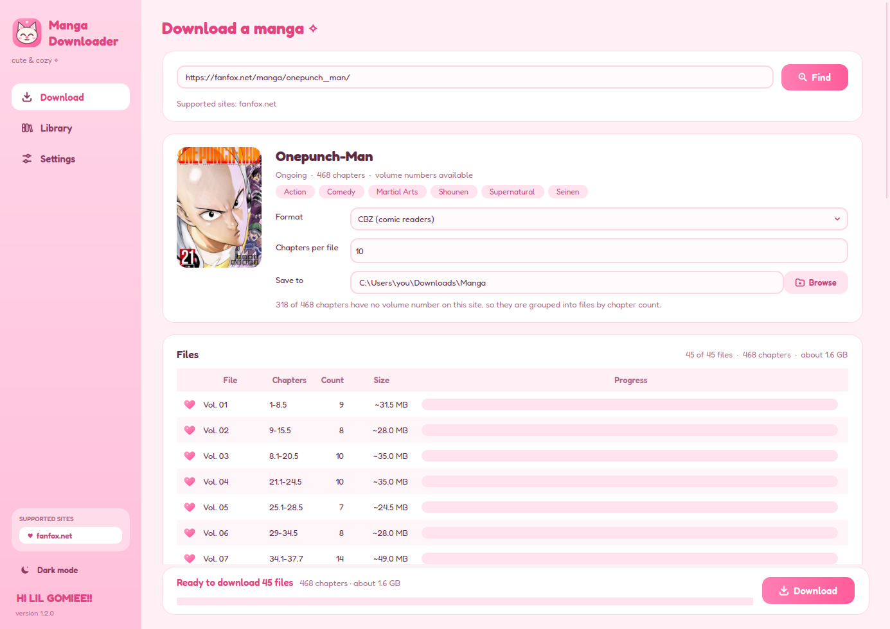
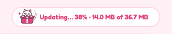

<p align="center">
  
</p>

<h1 align="center">Nyanga</h1>

<p align="center">
  <b>a cute &amp; cozy pink app that downloads manga for you ✦</b><br>
  <i>nyan + manga: the cat fetches your chapters</i><br>
  one file per volume: CBZ, PDF, EPUB or plain image folders
</p>

<p align="center">
  <a href="https://github.com/nyanga-app/nyanga-app/releases/latest"></a>
  <a href="https://github.com/nyanga-app/nyanga-app/releases"></a>
  
  
</p>

<p align="center">
  <picture>
    <source media="(prefers-color-scheme: dark)" srcset="assets/readme/cat-happy-dark.gif">
    
  </picture>
</p>

<p align="center">
  <a href="https://github.com/nyanga-app/nyanga-app/releases/latest"><b>⬇ Download for Windows or Linux</b></a>
  &nbsp;·&nbsp; <a href="https://nyanga.page">Website</a>
  &nbsp;·&nbsp; <a href="#-using-it">How to use it</a>
  &nbsp;·&nbsp; <a href="#-run-from-source">Run from source</a>
</p>

---

<p align="center">
  <picture>
    <source media="(prefers-color-scheme: dark)" srcset="assets/readme/screenshot-dark.png">
    
  </picture>
</p>

## ♥ What it does

- 🔎 **Search by name**: type a title, pick it from the results, and its cover, genres, story and
  every chapter show up, with the size of each file. Show the results as a list or a grid of covers,
  from small to very large, and sort them by best match, A to Z or newest; each result shows its rating and genres, and hovering it shows what it's about.
- 🎀 **Filters**: narrow a search down by genre (ones you want, ones you don't), kind (manga,
  manhwa, manhua…), ongoing or finished, and rating. Leave the name empty to browse everything
  that fits.
- 📚 **Volumes, not a pile of pages**: one CBZ, PDF or EPUB per volume, or per *N* chapters when the
  site has no volume numbers. Webtoon strips are cut into pages for EPUB.
- ⚡ **Fast but polite**: several files at once, with one shared speed limit so the site isn't flooded.
- 💾 **Picks up where it stopped**: cancel, close, come back later; finished files are skipped.
- 🗂️ **A Library**: every manga you've downloaded, how much of the series you have, and a "new"
  badge when chapters come out.
- 📖 **A reader built in**: read your downloads right in Nyanga, and it remembers the page you
  stopped on.
- 📱 **Send to your phone**: scan a QR code with your phone's camera and save the files straight
  from its browser, over your home Wi‑Fi. Nothing to install on the phone.
- 🌙 **Light and dark**, or follow your system.
- 🎁 **Updates itself**: when a new version is out, one click and it's done.

Supported sites: **fanfox.net** (`https://fanfox.net/manga/<title>/`)

## 🐾 Meet the cats

The cat on the icon is our mascot, and it shows up all over the app. They're drawn live in code,
so they follow the light and dark theme.

<table align="center">
  <tr>
    <td align="center" width="240">
      <picture>
        <source media="(prefers-color-scheme: dark)" srcset="assets/readme/cat-reading-dark.gif">
        
      </picture><br>
      <b>The bookworm</b><br><sub>reads while things load</sub>
    </td>
    <td align="center" width="240">
      <picture>
        <source media="(prefers-color-scheme: dark)" srcset="assets/readme/cat-happy-dark.gif">
        
      </picture><br>
      <b>The happy hopper</b><br><sub>cheers when a download is done</sub>
    </td>
    <td align="center" width="240">
      <picture>
        <source media="(prefers-color-scheme: dark)" srcset="assets/readme/cat-update-dark.gif">
        
      </picture><br>
      <b>The delivery cat</b><br><sub>brings you the new version</sub>
    </td>
  </tr>
</table>

Psst: give the cat in the top-left corner a tap ♥

## 💝 Install (Windows)

1. Open the [latest release](https://github.com/nyanga-app/nyanga-app/releases/latest) and
   download **Nyanga-Setup-x.y.z.exe**.
2. Run it. Windows may say "Windows protected your PC" because the app isn't signed: click
   **More info**, then **Run anyway**. No admin rights are needed. You only see this once:
   the installed app and its updates aren't flagged.
3. Open **Nyanga** from the Start menu.

That's the only time you install it ✦

## 🐧 Install (Linux)

1. Open the [latest release](https://github.com/nyanga-app/nyanga-app/releases/latest) and
   download **Nyanga-x86_64.AppImage**. It's the whole app in one file; there's nothing to install.
2. Put it somewhere it can stay (like `~/Applications`) and make it executable: right-click it,
   **Properties**, tick **Allow executing file as program** (or `chmod +x Nyanga-x86_64.AppImage`).
3. Double-click it to open Nyanga.
4. Want it in your app menu? Go to **Settings** and press **Add Nyanga to your app menu**
   (and **Remove** to take it out again). If a tool like Gear Lever or AppImageLauncher already
   added it, the button says so and stays out of the way.

If it doesn't open, your system may be missing FUSE: install `fuse3` (or `libfuse2` on older
systems) from your package manager.

**Prefer a package?** The same release has a `.deb` (Ubuntu, Debian, Mint) and an `.rpm`
(Fedora, openSUSE). Double-click it to install it from your software center, or from a terminal:

```sh
sudo apt install ./nyanga_*_amd64.deb      # Ubuntu, Debian, Mint
sudo dnf install ./nyanga-*.x86_64.rpm     # Fedora
```

Nyanga is then in your app menu right away. Step-by-step guides for every way are on
[nyanga.page/install](https://nyanga.page/install/).

### 🎁 Updates

When a new version is out, a card pops up with **Update now**. It downloads the new version,
installs it and reopens by itself. Your settings and library are kept (they live in
`%APPDATA%\Nyanga` on Windows; on Linux the settings are in `~/.config/Nyanga` and the
library in `~/.local/share/Nyanga`). On Linux the new version
takes the old AppImage's place, so keep it in a folder you can write to. Installed from the
`.deb` or `.rpm`, Nyanga keeps its updates in `~/.local/share/Nyanga/app` (no password needed),
so `apt`/`dnf` keep showing the version you first installed; Nyanga always opens the newest one. The first time it opens after an update, a **What's new** window lists
what changed since your last version, in plain words. Want to read it again? Click the version
at the bottom left, or see the whole [changelog](CHANGELOG.md).

Pressed **Later**? A button waits at the top right. While an update downloads with the card
closed, that spot shows the delivery cat and how far along it is:

<p align="center">
  
</p>

## 📖 Using it

**Download page**

1. Pick a source, type the manga's name and press **Search**. **Filters** opens genres (tap once
   for ones you want, twice to leave them out), kind, ongoing or finished, and rating; with filters
   on, the name can stay empty to browse. Click the right one in the
   results (use ‹ › under them for more, and the buttons next to **Pick one** to switch between a
   list and a grid of covers, pick their size, or sort them); its cover, title, genres, description
   (**Read more** for all of it) and chapter count appear.
   **Back to results** lets you pick another. Pasting a title link instead of a name works too.
2. Pick the format, the folder to save to and, if the site has no volume numbers for the
   title, how many chapters go in each file.
3. Tap the paws of the files you want. Shift-click a paw to tick everything since the last one
   you tapped, or drag across paws to tick (or untick) a run of them. Under the table:
   - **Select all / none**, and **Select page** for just the files on screen.
   - **New ✦**, **Not downloaded** and **Failed** pick files from your download history.
   - **Volumes / Chapters … to …** ticks every file in that range. Chapters that are in a volume
     are picked by volume; **Chapters** covers the newer ones that aren't in a volume yet.

   Long series are split into pages (20 files each, changeable in Settings); use ‹ › to flip.
   Tap a column title to sort by it: once for up, twice for down, a third time (or a
   right-click) to go back to normal.
4. Press **Download**. Each file gets its own progress bar; **Cancel** stops after the
   current page, and **Open folder** shows the results when it's done.

Running it again with the same choices resumes where it stopped. Files that already exist
are skipped, so delete a file to rebuild it. The exception: if the site has added chapters
to a volume you already have, that file is made again with them (the old one stays until
the new one is done).

Webtoons (long vertical strips) are cut into screen-sized pages in EPUB. CBZ and PDF keep
the original strips; use a reader with a continuous-scroll mode for those.

**Library page**

Press **Add to library** next to a manga's title to keep it here (downloading it adds it too),
and **Remove from library** to take it off again.
Each one gets a card with its cover, how much of the series you have (chapters downloaded out
of all chapters on the site), and what failed or is still waiting.

- **Read** asks which file, then opens it in Nyanga's own reader (CBZ, PDF, EPUB or an image
  folder). It starts where you left off. Turn pages with the arrow keys, the mouse wheel or by
  clicking the left or right side of the page. **Left to right** switches to right to left for
  manga read like the printed book, **Fit width** fills the window for long strips, and F11 is
  full screen.
- **Open** asks which file, then opens it in your computer's usual app for that kind of file.
- Both show which files you've read or opened before, and how far you got, with the last one
  already picked. The card also shows the last one.
- **Continue** picks up chapters from a download that was cancelled or interrupted.
- **Retry failed** downloads the chapters that failed again.
- **Folder** opens the folder with that manga's downloaded files.
- **Phone** sends that manga's files to your phone (see below).
- **Chapters** loads the manga on the Download page with what you already have marked, so you can
  pick more.
- Opening the page checks each manga for new chapters (at most once every 5 minutes) and shows
  a "new" badge.
- If you delete a downloaded file (or move it out of its folder), it no longer counts as
  downloaded and can be downloaded again.
- If a whole folder goes missing (renamed, moved, or on a drive that isn't plugged in), its files
  still count, and the card says it can't find them. **Find folder** points Nyanga at where the
  folder is now, and **Forget them** lets you download them again.
- The × on a card (or **Remove from library** on the Download page) takes a manga off the
  library. If it has downloaded files, you choose to keep them or delete them too. Kept files
  still count: open that manga again and it shows what you have, ready to add back.

**Send to your phone**

Tick the files you want and scan the QR code with your phone's camera. A page opens in the
phone's browser with a **Save** button for each file, **Save all as one zip**, and **Save all as
separate files** (one after another, in order). The phone and
computer need to be on the same Wi‑Fi; nothing goes through the internet.

- The first time on Windows, it may ask whether Nyanga can use the network: press **Allow**.
- Sharing stops when you close the window, or by itself after 15 minutes of nothing happening.
- If the phone can't open the page, turn off any VPN on it. Some guest or school Wi‑Fi keeps
  devices apart, so it won't work there.
- On an iPhone, saved files go to **Files → Downloads**. Keep the screen on until a big download
  finishes.
- PDF and EPUB open on any phone. CBZ needs a comic reader app, and image folders arrive as zips.
- Older iPhones and iPads (iOS 12 and earlier) can't download from a browser, so there each file
  has **Open**: it opens in its own tab, then use **Open in…** to hand it to an app that keeps it.
  The save-all buttons don't show there.

**Settings page**

- Theme: light, dark, or match your system (the moon/sun button in the sidebar switches too).
- Default source: the site the Download page searches unless you pick another.
- Default download folder and temp folder, and whether to keep temp files.
- Default format and chapters per file.
- Files per page: how many files the Download page lists at once.
- Change something and **Save** or **Undo** it before leaving the page. Saving new defaults
  also updates a manga that's open on the Download page, except for the fields you changed
  there yourself.
- **Files at once**: how many files are made in parallel. `1` does one at a time.
- **Run downloads on**: threads (recommended) or separate processes. Downloading mostly waits
  on the network, so processes rarely help; building files uses separate cores either way.
- **Delay between requests**: shared by all workers, so more workers never means more
  requests per second. Sites ask for human browsing speed; going too low can get you blocked.

Settings and history are saved in `%APPDATA%\Nyanga` in the installed app on Windows,
`~/.config/Nyanga` (settings) and `~/.local/share/Nyanga` (library) in the Linux AppImage, or next to
`nyanga.py` (`settings.json` and `library/`, both git-ignored) when running from source.

**Something not working?** Start Nyanga with `--debug` and it writes everything it does to
`nyanga-debug.log` in a `logs` folder next to your settings and library. Then do the thing that
goes wrong again and send me that file.

- Windows: press Win+R, paste `"%LOCALAPPDATA%\Programs\Nyanga\Nyanga.exe" --debug` and press
  Enter. The log is in `%APPDATA%\Nyanga\logs`.
- Linux: run `nyanga --debug` (or the AppImage with `--debug`). The log is in
  `~/.local/share/Nyanga/logs`. You can also set `NYANGA_DEBUG=1` instead of the flag.
- From source: `.venv/bin/python nyanga.py --debug`. The log is in `logs/` (git-ignored) and also
  shows in the terminal.

## 🛠️ Run from source

Needs Python 3.10 or newer. Run these from the project folder.

Linux / macOS:

```sh
python3 -m venv .venv
.venv/bin/pip install -r requirements.txt
.venv/bin/python nyanga.py
```

Windows (PowerShell):

```powershell
py -m venv .venv
.venv\Scripts\pip install -r requirements.txt
.venv\Scripts\python nyanga.py
```

After the first time, only the last line is needed.

## 🧶 Contributing

- Code layout: `core.py` (sites, rate limiting, download pipeline), `builders.py` (output
  formats), `gui.py` (the window), `loader.py` (the cats), `updater.py` (checks GitHub for new
  versions and installs them), `paths.py` (where assets and user data live, from source and in
  the exe).
- To add a site, write a class like `FanFox` in `core.py` with `name`, `home`, `url_re`, `search()`, `info()`,
  `page_urls()` and `image()`, and add it to `SITES`. For filters, give it `genres` and `kinds`
  lists and let `search()` take a `SearchFilters`; a `sorts` list and a `sort` argument add sorting; `about()` adds ratings and genres to its search results. It then shows up as a source to search.
- Commit messages are [conventional commits](https://www.conventionalcommits.org) (`fix:`,
  `feat:`, `docs:`...). They decide the next version and become the release notes; the subject and body also show
  up in the app's What's new window, so write them for someone who's never seen the code.
- Please follow the [code of conduct](CODE_OF_CONDUCT.md) ♥

## ✿ Credits

The interface uses the bundled [Fredoka](https://github.com/hafontia/Fredoka-One) font
(`assets/fonts`, SIL Open Font License, see `assets/fonts/OFL.txt`). The cats, the icons and
the mascot were drawn for this project.

## 📜 License

Nyanga is source-available, not open source. You can use it, read the code and fork it to send
contributions back here, but you can't publish your own version or build another app from it.
See [LICENSE](LICENSE) for the details.

<p align="center">
  <sub>made with ♥ and a lot of cat drawings</sub>
</p>
